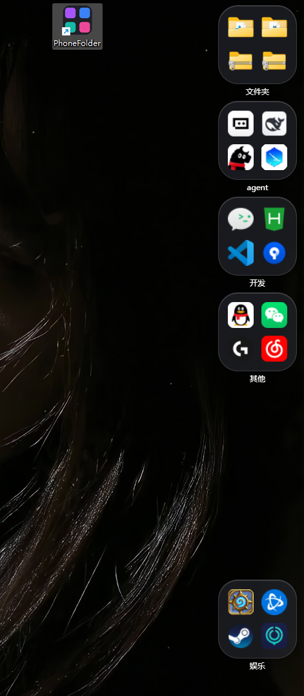
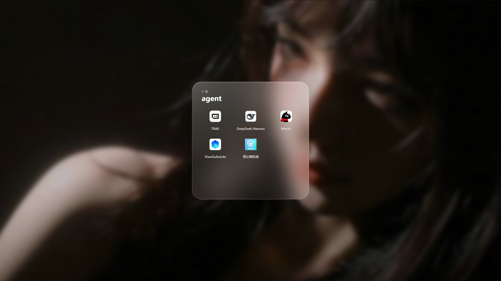
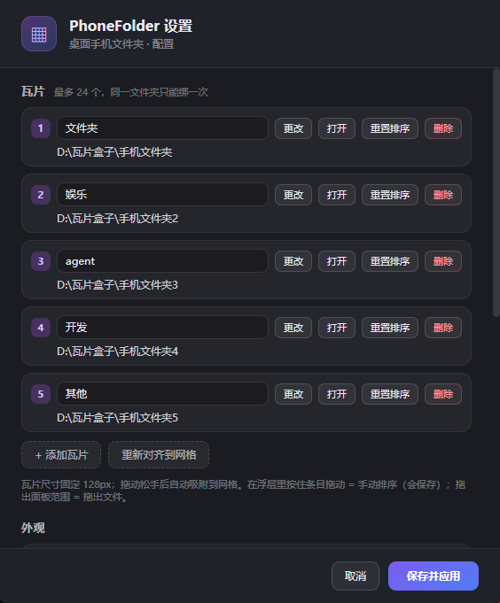

# PhoneFolder

PhoneFolder is an open-source Windows desktop utility for managing a phone folder on the desktop, with Android file access, drag-and-drop organization, and a clean desktop-side file storage experience.

Windows + Android + desktop file manager + phone folder access + open source project

PhoneFolder helps you keep a phone folder on your Windows desktop like a convenient local file area. You can drag files, folders, and shortcuts into the tile, open items directly from Windows Explorer, and organize your phone content without replacing the default File Explorer.

## What is PhoneFolder?

PhoneFolder is a lightweight Windows desktop app that adds a persistent tile on the desktop. It acts as a dedicated “phone folder” entry point, allowing you to collect and manage files from your phone in a simple, visual way.

This project is designed for users who want:

- a phone folder accessible from the Windows desktop
- drag-and-drop file organization on the desktop
- a dedicated place for mobile files without cluttering the desktop
- an open-source desktop software for phone storage management
- a lightweight UI for managing files without opening full file managers

## Core Features

- Desktop tile entry for a phone folder
- File and folder collection from the desktop
- Drag items into the folder and move them back out
- Open files directly in Windows Explorer
- Bind a custom folder and manage it easily
- Multi-tile support with up to 24 tiles
- Desktop-level tile mode and normal window mode
- Tray icon integration and one-click show/hide
- Windows desktop interaction with blur, dimming, and glass effects

## Project Focus

PhoneFolder is not a replacement for Windows Explorer. Instead, it adds a desktop “folder portal” that keeps your phone-related files in one visual and easy-to-use place.

It is especially useful for:

- desktop users who want quick access to phone files
- Android users who want a convenient Windows-side folder workflow
- people who prefer drag-and-drop desktop organization
- open-source software enthusiasts who want a simple Windows desktop utility

## Screenshot Preview







## Current Progress

| 阶段 | 状态 | 说明 |
|---|---|---|
| P0 脚手架 | ✅ 完成 | pnpm + Electron 43.3.0，main/preload/renderer 分层，`pnpm shot` 截图 |
| P1 视觉原型 | ✅ 完成 | 瓦片 UI、全屏浮层、壁纸模糊、开合动画 |
| P2 真实内容 | ✅ 完成 | 真实文件夹扫描、缩略图、3×3 分页、点击打开、右键菜单、fs.watch 刷新、空态/错误态 |
| P3 拖放 | ✅ 完成 | 拖入移入（重名 (n)、跨盘回退、跳过已在内）、单文件拖出、拖入高亮/toast |
| P4 系统集成 | ✅ 完成 | 托盘、设置页、开机自启、单实例、多瓦片（≤24） |
| P5 打磨打包 | ✅ 完成 | 性能实测、内存优化、electron-builder 便携版 |
| v0.6 行为修正 | ✅ 完成 | 默认空瓦片 + 从桌面拖入收纳（旧配置自动迁移）；空瓦片去图标、面板同款实线玻璃边；修复二次打开不居中 |
| v0.7 收纳位置 | ✅ 完成 | 收纳文件夹移出桌面（放到桌面同级，如同盘 `D:\手机文件夹`）；旧隐藏目录自动迁移清空 |
| v0.7.1 图标修复 | ✅ 完成 | `.lnk` / `.exe` 显示真实软件图标 |
| v0.8 交互细节 | ✅ 完成 | 修复 hover 顶部裁切、瓦片大小真正生效；点浮层标题重命名；面板隐藏 `.lnk` 后缀 |
| v0.10–v0.12 | ✅ 完成 | 拖出改为 pointer 触发原生拖拽；桌面级瓦片优化；修复重复打开问题 |

- 开发计划：[docs/开发计划.md](docs/开发计划.md)
- 阶段记录：[P1](docs/P1-进展.md) · [P2](docs/P2-进展.md) · [P3](docs/P3-进展.md) · [P4](docs/P4-进展.md) · [P5](docs/P5-进展.md) · [v0.6](docs/v0.6-进展.md) · [v0.7](docs/v0.7-进展.md)

## Release / Run

| 产物 | 大小 | 用法 |
|---|---|---|
| `release/PhoneFolder-0.12.1-setup.exe` | 102.8 MB | 安装版：双击安装（当前用户，无需管理员），自动创建桌面/开始菜单快捷方式 |
| `release/PhoneFolder-0.12.1-portable.exe` | 93.6 MB | 双击即用（自解压到临时目录运行） |
| `release/PhoneFolder-0.12.1-win.zip` | 133.1 MB | 解压后运行 `win-unpacked/PhoneFolder.exe` |

- SHA-256 前 16 位：setup `C37FF5CC7493A9C0` · portable `5BDEBB4EAE7E7183` · zip `95DB9C2858CFB6B3`
- 未签名，首次运行 SmartScreen 提示 → 「更多信息 → 仍要运行」
- 配置目录：`%APPDATA%\phone-folder\config.json`

> 本机注意：项目 `release/` 目录继承了当前会话的沙箱 ACL，直接在里面运行 EXE 会启动失败（没反应）。
> 当前版本已解压部署到 `D:\PhoneFolder\PhoneFolder-0.12.1`，桌面快捷方式与开机自启都指向它。

## Default Behavior: Empty Tile + Storage Folder

- 收纳文件夹在**桌面目录的同级**：本机桌面是 `D:\deskTop`，所以收纳目录是 **`D:\手机文件夹`**。
- 首次启动自动创建这个目录，瓦片绑定它 → 默认是空的。
- 从桌面把文件/快捷方式/文件夹拖到瓦片上 → 移进收纳文件夹。
- 从浮层把条目拖回桌面 = 移出。
- 右键瓦片 → 「打开绑定文件夹」可查看管理目录。

## Development

```powershell
pnpm install
pnpm start
pnpm shot
```

## Build

```powershell
$env:ELECTRON_MIRROR='https://npmmirror.com/mirrors/electron/'
$env:ELECTRON_BUILDER_BINARIES_MIRROR='https://npmmirror.com/mirrors/electron-builder-binaries/'
pnpm dist
```

## Interaction

- 单击瓦片：展开浮层；再点瓦片位置 / 点面板外 / 按 Esc：收起
- 拖动瓦片：自由跟随移动，松手自动吸附到网格
- 右键瓦片：展开 / 打开绑定文件夹 / 重新扫描 / 添加瓦片 / 设置 / 删除此瓦片 / 退出
- 浮层：滚轮 / ←→ / 左右滑动翻页；单击条目打开
- 重命名：点浮层里的大标题 → 直接输入，Enter 保存 / Esc 取消
- 托盘：左键切换瓦片显示/隐藏；右键菜单：显示/隐藏瓦片、打开设置、打开绑定文件夹、重新扫描、退出
- 设置页：瓦片增删/更换文件夹/改显示名/打开目录/重置排序等
- 文件变化：文件夹内增删改 300ms 内自动刷新浮层和瓦片预览

## Keywords / Search Terms

For better discoverability, the project is aligned with terms such as:

- PhoneFolder
- Windows phone folder
- Android file folder on Windows
- desktop phone storage
- Windows file management
- Android file access on desktop
- open source phone folder app
- Windows desktop file organizer
- drag and drop phone files
- mobile folder management
- phone directory on desktop
- file organizer for Android on Windows

## Related Project Type

This project fits the category of:

- open-source Windows desktop utility
- Android file access helper
- desktop file organizer
- file management app for phone files
- lightweight desktop storage portal

## Directory Structure

```text
D:\deskTop\phoneS\
├─ package.json / .npmrc / .gitignore / electron-builder.yml
├─ assets\                 icon.ico / icon.png
├─ docs\                   开发计划 + P1~P5 + v0.6~v0.12 进展
├─ scripts\                E2E / 诊断 / 截图辅助脚本
├─ shots\                  截图产物
├─ release\                打包产物
├─ src\
│  ├─ main\
│  │  ├─ main.js
│  │  ├─ windows\
│  │  └─ services\
│  ├─ preload\
│  └─ renderer\
└─ tests\unit\run.js
```

## Known Limitations

- 未签名 → SmartScreen 首次提示
- 桌面级瓦片为实验特性：仅主显示器；多显示器 / 混合 DPI 未适配
- 收纳是移动语义：文件从桌面移进收纳文件夹
- 默认收纳目录在桌面同级；若手动改到桌面中，则会显示在桌面中
- 托盘「显示/隐藏瓦片」不持久化

## Summary

PhoneFolder is an open-source desktop utility for creating a Windows phone folder experience, giving users a desktop-side folder for Android content and convenient drag-and-drop file management.

It is designed for people who want a practical, lightweight way to organize mobile files from the desktop without replacing the normal Windows file browser.

PhoneFolder – Windows Phone Folder for Desktop

PhoneFolder – Android file access and organization on Windows

PhoneFolder – open source Windows desktop utility for phone folder management
